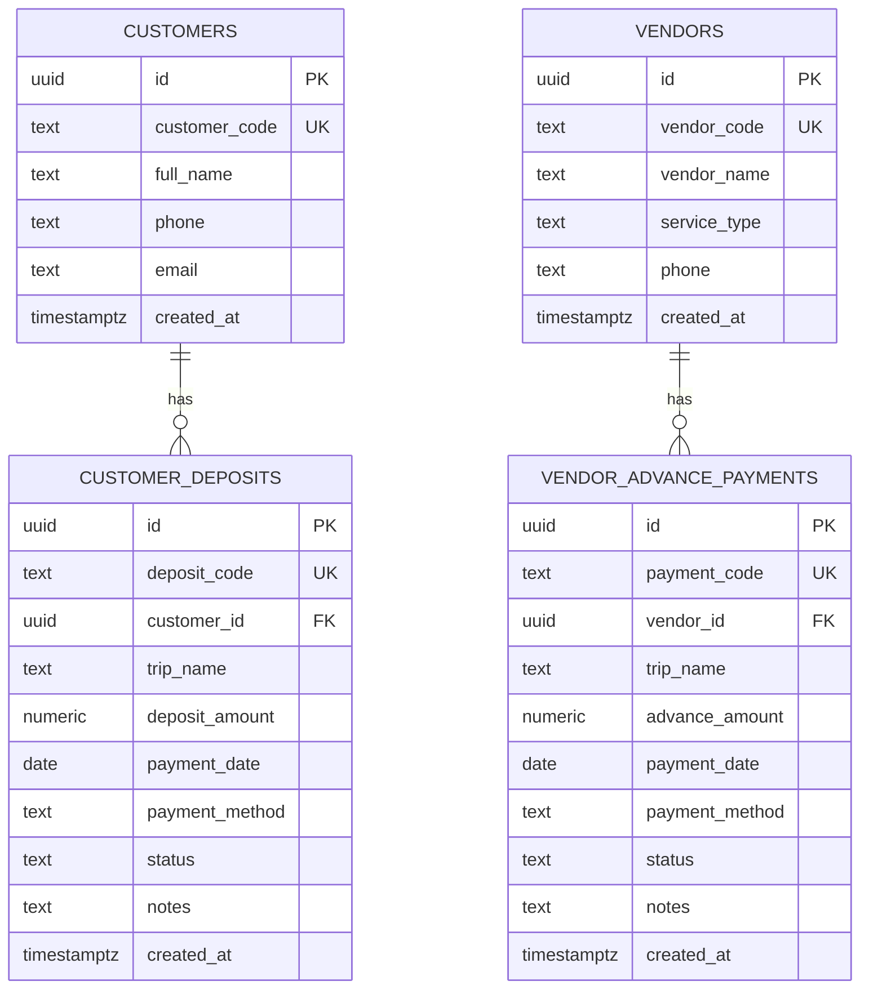

# TripFund

TripFund adalah dashboard tanpa login untuk membantu travel planner mencatat data pelanggan, vendor, deposit pelanggan, dan pembayaran uang muka vendor. Antarmuka menggunakan HTML, CSS, dan Vanilla JavaScript; PostgreSQL dikelola oleh Supabase.

## Fitur

- Ringkasan total deposit berstatus `paid`, uang muka vendor berstatus `paid`, selisih dana tercatat, jumlah transaksi, dan transaksi pending.
- CRUD master data pelanggan dan vendor.
- Pencatatan, pengubahan, pencarian, penyaringan, dan pembatalan transaksi deposit serta uang muka vendor.
- Validasi data di browser dan database.
- Aplikasi langsung membuka dashboard tanpa login.
- Tampilan responsif dan format mata uang Rupiah.

**Selisih Dana Tercatat** adalah total deposit paid dikurangi total uang muka vendor paid. Nilai ini bukan saldo rekening, laba, atau dana tersedia yang telah direkonsiliasi.

## Struktur proyek

```text
TripFund/
├── back-end/
│   ├── app.js                  # Browser integration module for Supabase
│   └── database.sql
├── front-end/
│   ├── index.html
│   ├── style.css
│   └── script.js
└── README.md
```

Supabase adalah layanan database PostgreSQL dan backend terkelola yang dipakai TripFund. Karena itu kode integrasinya berada di `back-end/app.js`; file ini berjalan di browser dan bukan server Node.js. Tidak ada folder `supabase` terpisah atau backend server tambahan. Tidak diperlukan Node.js, npm, atau proses build.

## ERD



Database memiliki tepat empat tabel utama. Setiap pelanggan dapat memiliki banyak deposit, dan setiap vendor dapat memiliki banyak pembayaran uang muka. Transaksi menyimpan `trip_name` sendiri; relasi deposit tertentu dengan uang muka vendor tertentu tidak dicatat oleh rancangan ini.

## Persiapan database

1. Buat project di Supabase Dashboard.
2. Buka **SQL Editor** dan jalankan isi `back-end/database.sql`. Jalankan SQL sebelum membuka aplikasi. SQL tidak dijalankan otomatis oleh halaman web.
3. SQL mengaktifkan RLS dan memberi akses CRUD kepada role `anon` agar sistem dapat digunakan tanpa login. SQL juga menyertakan migrasi vendor untuk tabel lama yang belum memiliki kolom vendor baru; perubahan itu mempertahankan baris vendor yang ada.
4. Buka `back-end/app.js` dan pastikan `SUPABASE_URL` serta `SUPABASE_ANON_KEY` berisi project URL dan **publishable key** project yang sama. Hanya publishable key yang boleh ada di browser.
5. Jika project sudah pernah menjalankan SQL sebelumnya, jalankan ulang seluruh isi `back-end/database.sql` setelah perubahan schema atau RLS agar migrasi, policy, dan hak akses terbaru diterapkan.

### Catatan keamanan

- **Peringatan:** kebijakan `anon` memberi siapa pun yang dapat menjangkau URL/key project kemampuan membaca, menambah, mengubah, dan menghapus seluruh data pada tabel TripFund. Publishable key memang boleh berada di browser dan bukan rahasia; RLS terbuka ini tidak melindungi data.
- Gunakan mode tanpa login ini hanya untuk demo atau data non-sensitif. Jangan gunakan dengan data keuangan/pelanggan nyata atau publikasikan sebagai sistem produksi.
- Jangan pernah menaruh `service_role` key atau secret key di file front-end.
- Untuk produksi, hapus kebijakan anon dari SQL dan ganti dengan Supabase Auth serta kebijakan RLS yang membatasi akses sesuai pengguna/organisasi.

## Menjalankan aplikasi

1. Buka folder proyek di Visual Studio Code.
2. Pastikan SQL sudah dijalankan dan URL/key Supabase sudah dikonfigurasi.
3. Untuk membuka halaman dengan double-click, buka file `front-end/index.html` melalui File Explorer. Halaman dan antarmuka berjalan sebagai skrip klasik, tidak menggunakan JavaScript ES module.
4. Agar request Supabase berhasil dari `file://`, browser/proyek harus menerima request dari origin `null`. Jika koneksi browser atau kebijakan CORS Supabase memblokirnya, gunakan **Live Server** di VS Code dengan HTTP/HTTPS.
5. Dashboard langsung terbuka tanpa login. Jika terjadi masalah, periksa notifikasi aplikasi dan Developer Tools → Console/Network browser.

Browser dapat membatasi request jaringan yang berasal dari `file://` sebagai origin `null`; karena itu double-click menjamin antarmuka dapat dibuka, tetapi tidak menjamin browser/proyek mengizinkan koneksi database. Live Server atau static hosting HTTP/HTTPS adalah cara yang disarankan untuk penggunaan Supabase yang konsisten.

## Publikasi ke GitHub Pages

1. Pastikan seluruh folder `back-end/` dan `front-end/` serta `README.md` sudah diunggah dan di-push ke branch yang akan dipublikasikan (umumnya `main`).
2. Di repository GitHub, buka **Settings → Pages**.
3. Pada **Build and deployment**, pilih **Deploy from a branch**.
4. Pilih branch `main` dan folder `/(root)`, lalu tekan **Save**. Untuk halaman HTML statis ini tidak perlu GitHub Actions workflow atau proses build.
5. Tunggu deployment selesai di bagian Pages/Actions.
6. Karena tidak ada `index.html` di root, buka halaman aplikasi dengan URL `https://<username>.github.io/<nama-repository>/front-end/index.html`. URL utama repository dapat menampilkan 404.

GitHub Pages menerbitkan situs secara publik. Karena konfigurasi Supabase saat ini memberi akses database kepada role `anon`, siapa pun yang dapat mengakses situs berpotensi membaca dan mengubah data. Jangan publikasikan dengan data sensitif; amankan RLS/Auth sebelum penggunaan nyata.

## Pemecahan masalah

### Dashboard terbuka tetapi data tidak dapat ditambah atau dihapus

1. Pastikan `SUPABASE_URL` dan publishable key pada `back-end/app.js` berasal dari project Supabase yang sama.
2. Jalankan ulang seluruh SQL terbaru dari `back-end/database.sql` lewat **Supabase Dashboard → SQL Editor**. Perubahan file lokal tidak mengubah schema atau policy yang sudah diterapkan pada project.
3. Pastikan SQL berjalan sampai selesai tanpa pesan error. Bagian RLS harus membuat policy `Anonymous users can manage ...` untuk keempat tabel dan memberikan `GRANT` tabel kepada role `anon`.
4. Muat ulang aplikasi dan coba lagi. Buka Developer Tools → **Console** dan **Network** untuk melihat error dari Supabase.
5. Jika masih muncul `new row violates row-level security policy`, policy anonim tidak ada/berbeda di database atau request menggunakan project URL/key yang berbeda. Jangan mengatasi masalah dengan memasukkan `service_role` key ke browser.

Penghapusan pelanggan atau vendor yang masih memiliki transaksi memang akan ditolak oleh foreign key `ON DELETE RESTRICT`. Batalkan atau pertahankan riwayat transaksi; jangan menghapus constraint untuk memaksa penghapusan master.

## Aturan data

- Nominal disimpan sebagai `NUMERIC(15,2)` dan harus lebih besar dari nol.
- Status transaksi: `pending`, `paid`, atau `cancelled`.
- Metode pembayaran database: `transfer_bank`, `tunai`, `kartu`, `ewallet`, atau `lainnya`.
- Hanya transaksi berstatus `paid` yang masuk ke total dana dashboard.
- Transaksi dibatalkan dengan mengubah status ke `cancelled`, bukan menghapus riwayat.
- Penghapusan pelanggan/vendor yang masih memiliki transaksi ditolak oleh foreign key `ON DELETE RESTRICT`.
- Tanggal transaksi menggunakan `DATE`, sedangkan waktu pencatatan menggunakan `TIMESTAMPTZ`.

## Checklist pengujian manual

- [ ] Jalankan `back-end/database.sql` di Supabase SQL Editor dan pastikan empat tabel tersedia.
- [ ] Pastikan aplikasi langsung membuka dashboard tanpa meminta login.
- [ ] Tambahkan, edit, cari, dan hapus pelanggan yang tidak memiliki transaksi.
- [ ] Tambahkan, edit, cari, dan hapus vendor yang tidak memiliki transaksi.
- [ ] Buat deposit untuk pelanggan yang valid; uji kode duplikat dan nominal nol/negatif.
- [ ] Buat uang muka vendor untuk vendor yang valid; uji kode duplikat dan nominal nol/negatif.
- [ ] Pastikan foreign key menolak transaksi dengan pelanggan/vendor yang tidak valid.
- [ ] Periksa filter status/tanggal dan pencarian pada tabel transaksi.
- [ ] Pastikan transaksi pending dan cancelled tidak masuk perhitungan paid.
- [ ] Pastikan pembatalan mempertahankan transaksi dan penghapusan master terkait transaksi ditolak.
- [ ] Periksa tampilan ponsel serta pesan error dan loading di browser.
- [ ] Pastikan kebijakan anon bekerja sesuai konfigurasi dan ingat bahwa akses ini terbuka untuk publik.

Checklist tersebut adalah panduan pengujian; hasilnya belum dinyatakan lulus sampai setiap langkah benar-benar dijalankan terhadap project Supabase yang dikonfigurasi.
